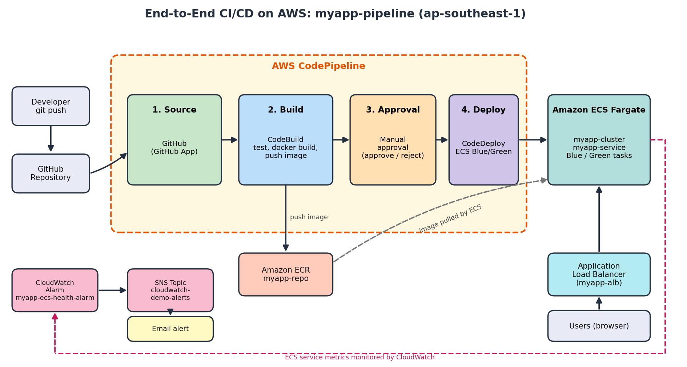
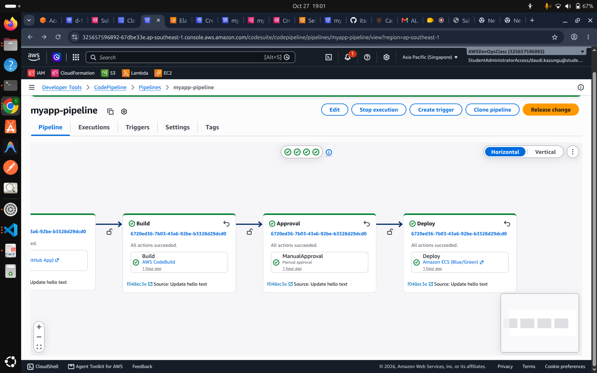
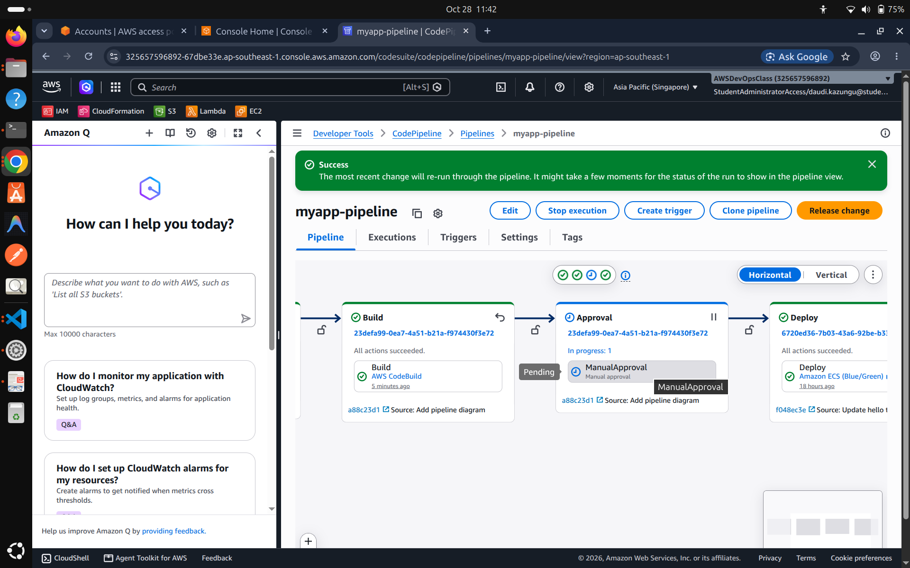
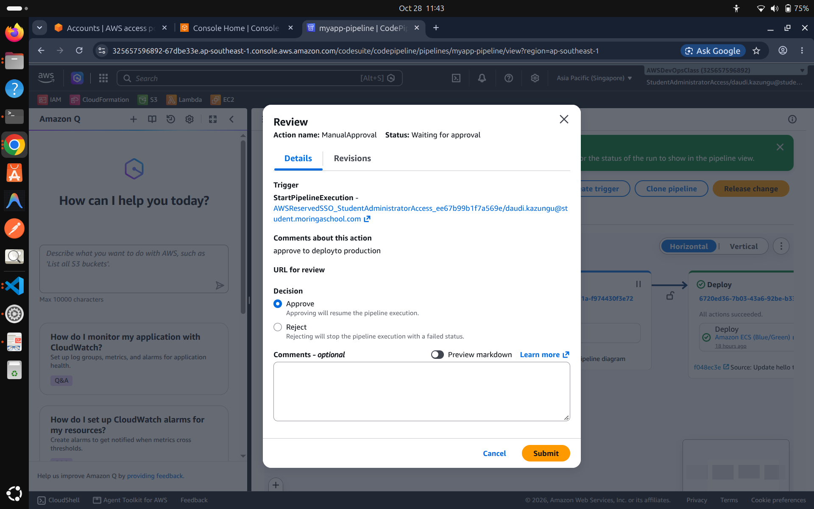
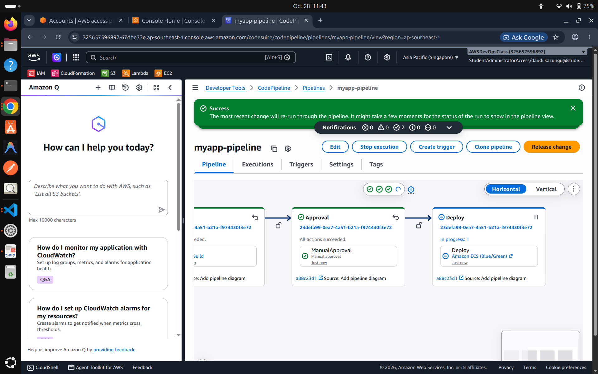
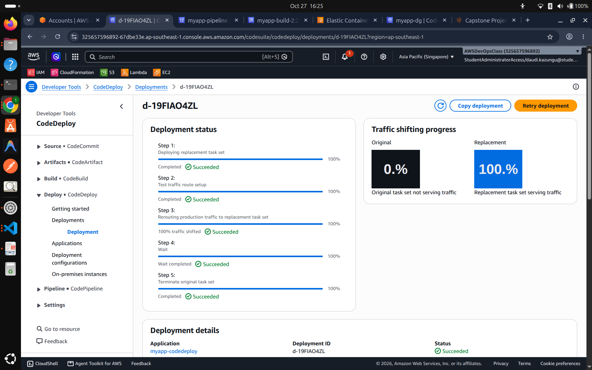
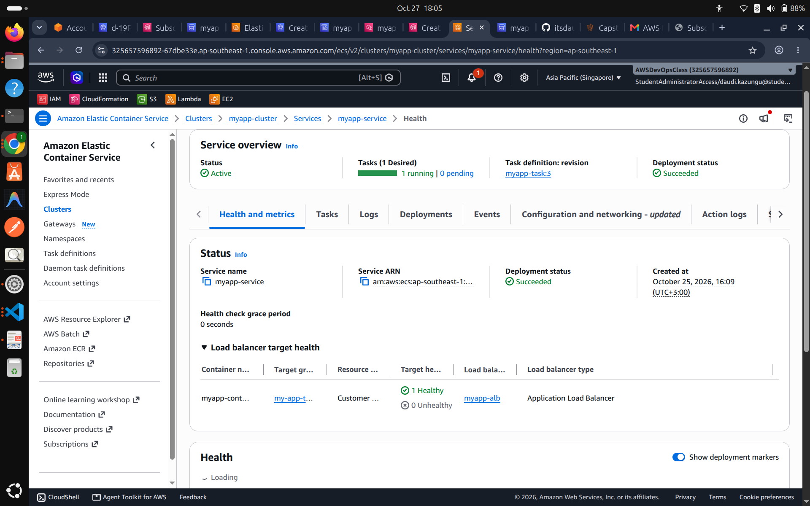
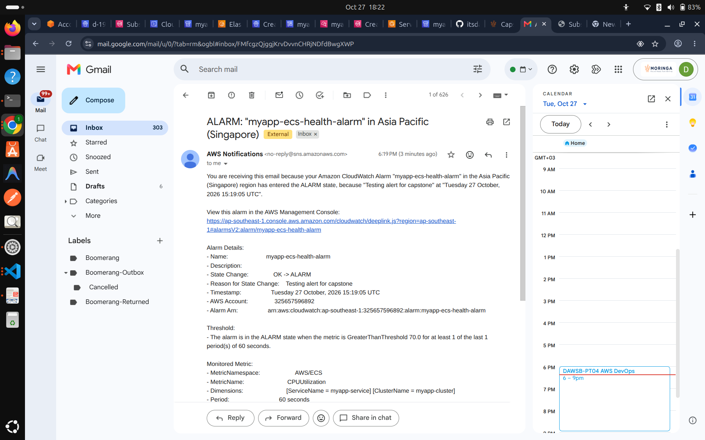
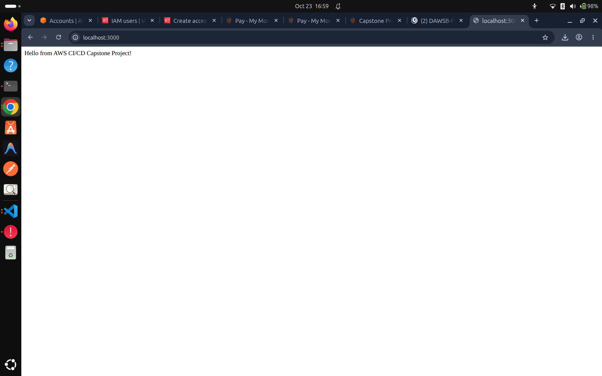

# End-to-End CI/CD on AWS (Capstone Project 2)

A fully automated CI/CD pipeline on AWS. A commit pushed to GitHub is built and tested, packaged as a Docker image, pushed to Amazon ECR, held for manual approval, and then deployed to Amazon ECS (Fargate) behind an Application Load Balancer using a Blue/Green deployment.

## Architecture



```
Developer -> GitHub -> CodePipeline
                         |-- Source:   GitHub (via GitHub App connection)
                         |-- Build:    CodeBuild -> test -> Docker build -> push to ECR
                         |-- Approval: Manual approval
                         '-- Deploy:   CodeDeploy (ECS Blue/Green)
                                          |
                                          v
                        ECS Fargate service <- Application Load Balancer <- Users

CloudWatch Alarm -> SNS topic -> Email notification
```

| Component | Purpose |
|---|---|
| GitHub | Source code repository and pipeline trigger |
| AWS CodePipeline (`myapp-pipeline`) | Orchestrates all stages |
| AWS CodeBuild | Installs dependencies, runs tests, builds and pushes the Docker image |
| Amazon ECR (`myapp-repo`) | Stores Docker images |
| AWS CodeDeploy | Blue/Green deployment to ECS with zero downtime |
| Amazon ECS Fargate (`myapp-cluster`, `myapp-service`) | Runs the container |
| Application Load Balancer (`myapp-alb`) | Routes traffic to healthy tasks |
| Amazon CloudWatch + SNS | Monitors service health and sends email alerts |

**Region:** Asia Pacific (Singapore), `ap-southeast-1`

## Repository structure

```
myapp/
├── src/
│   ├── app.js
│   ├── package.json
│   └── package-lock.json
├── tests/
│   └── app.test.js
├── Dockerfile
├── buildspec.yml
├── appspec.yml
├── taskdef.json
├── pipeline-diagram.png
└── README.md
```

| File | Description |
|---|---|
| `src/app.js` | Express.js web app that returns a greeting on port 3000 |
| `tests/app.test.js` | Jest unit tests |
| `Dockerfile` | Containerizes the app |
| `buildspec.yml` | CodeBuild instructions: log in to ECR, test, build, push, and produce deployment artifacts |
| `appspec.yml` | Tells CodeDeploy how to update the ECS service |
| `taskdef.json` | ECS task definition template (Fargate, awsvpc, port 3000) |
| `pipeline-diagram.png` | Diagram of the final pipeline flow |

## Pipeline stages

1. **Source:** a push to the GitHub repository triggers the pipeline.
2. **Build:** CodeBuild runs the `buildspec.yml`:
   - Logs in to Amazon ECR
   - Installs dependencies and runs the unit tests (the build fails if tests fail)
   - Builds the Docker image and tags it with the short commit ID
   - Pushes the image to the `myapp-repo` ECR repository
   - Outputs the deployment artifacts used by CodeDeploy
3. **Approval:** the pipeline pauses until a reviewer approves or rejects in the CodePipeline console. Rejecting stops the release, so nothing reaches production.
4. **Deploy:** CodeDeploy (Amazon ECS Blue/Green) registers a new task definition revision, starts the new tasks on the green target group, shifts ALB traffic to them, and then terminates the old tasks.

### Approval stage behavior

| Action | Result |
|---|---|
| Approve | Deploy stage runs and the new version goes live |
| Reject | Pipeline stops at Approval and the live version is unchanged |

Both paths were tested (see Screenshots).

## Monitoring

- **CloudWatch alarm:** `myapp-ecs-health-alarm` watches the `AWS/ECS` `CPUUtilization` metric for `myapp-service` in `myapp-cluster` (alarms when average CPU is above 70% for 1 minute).
- **SNS:** the alarm publishes to the SNS topic `cloudwatch-demo-alerts`, which sends an email to the subscribed address.
- **Alert test:** the notification was verified by setting the alarm state to ALARM and receiving the alert email.

## Setup

### Prerequisites

- AWS account with permissions for CodePipeline, CodeBuild, CodeDeploy, ECR, ECS, ELB, CloudWatch, SNS and IAM
- GitHub repository connected to CodePipeline through a GitHub App connection
- Node.js 16+ and Docker for local development

### One-time AWS setup

1. Create an ECR repository named `myapp-repo`.
2. Create an ECS Fargate cluster, task definition (`myapp-task`) and service (`myapp-service`) with an Application Load Balancer and two target groups (blue and green).
3. Create a CodeDeploy application and deployment group for ECS (Blue/Green).
4. Create a CodeBuild project with **Privileged mode** enabled, so Docker builds work.
5. Create the CodePipeline with the stages Source, Build, Approval and Deploy.
6. Create the SNS topic, confirm the email subscription, and create the CloudWatch alarm.
7. Replace the placeholders in the config files:
   - `<account_id>` with your AWS account ID in `buildspec.yml` and `taskdef.json`
   - `<TASK_DEFINITION>` is left as is in `appspec.yml` (CodeDeploy fills it in)

### Run locally

```bash
cd src
npm install
npm start          # http://localhost:3000
npm test           # run unit tests
```

```bash
docker build -t myapp .
docker run -p 3000:3000 myapp
```

## Deploying a change

1. Edit the code and push to GitHub.
2. The pipeline starts automatically and runs Source and Build.
3. Open CodePipeline, click **Review** on the Approval stage, and choose **Approve**.
4. After Deploy succeeds, open the ALB DNS name in a browser to see the new version.

## Screenshots

### CI/CD pipeline

*All four stages (Source, Build, Approval, Deploy) succeeded.*

### Manual approval
<p>
  
  
  
</p>

*Left to right: pipeline paused at Approval, the review dialog, and the pipeline continuing to Deploy after approval.*

### Blue/Green deployment

*CodeDeploy shifted 100% of traffic to the replacement task set and terminated the original.*

### ECS service

*One running task, one healthy target behind the Application Load Balancer.*

### Monitoring

*Email received from the CloudWatch alarm through SNS.*

### Local run


## Troubleshooting notes

- `aws ecr get-login` is not available in AWS CLI v2. Use `aws ecr get-login-password | docker login --username AWS --password-stdin <registry>`.
- Docker builds in CodeBuild fail unless **Privileged** mode is enabled on the project.
- A CloudWatch alarm stays on "Insufficient data" if its dimensions (`ClusterName`, `ServiceName`) do not match the real ECS service.
- Approval emails and alarm emails only arrive after the SNS email subscription is **Confirmed**.
